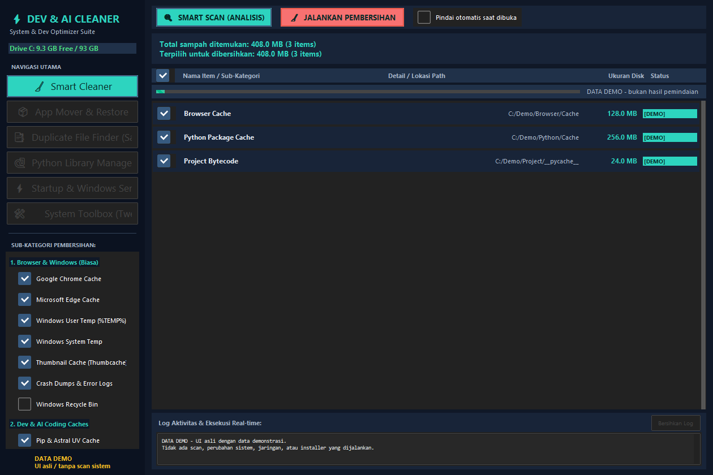
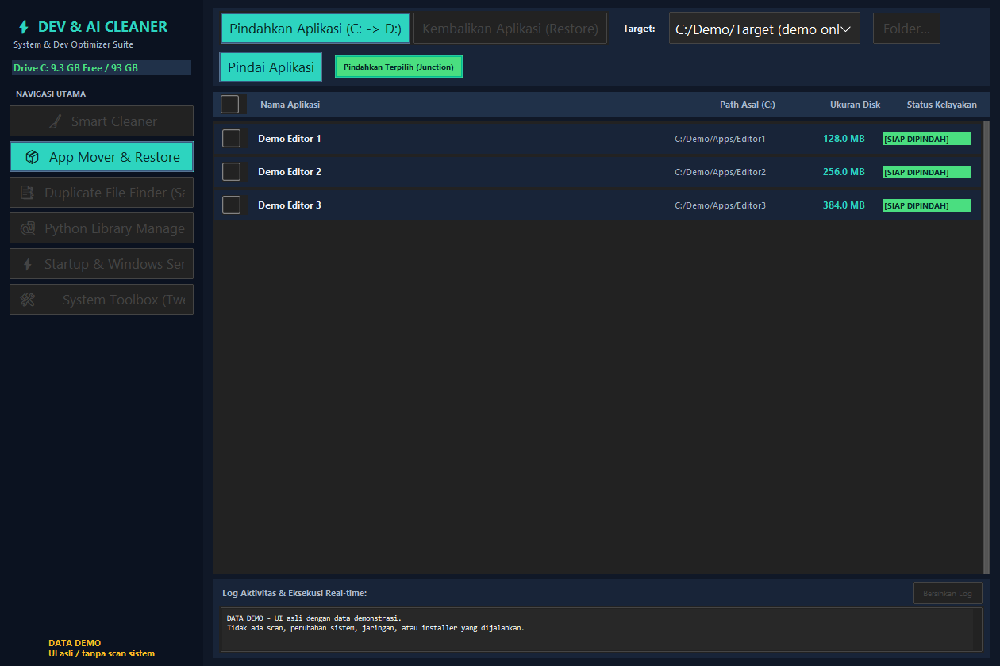
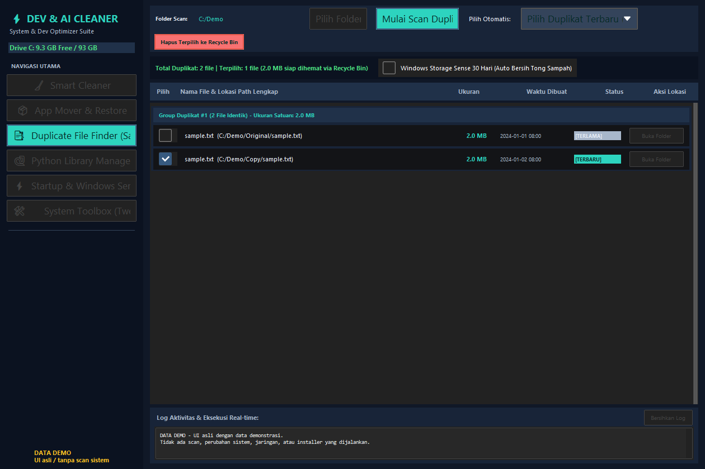
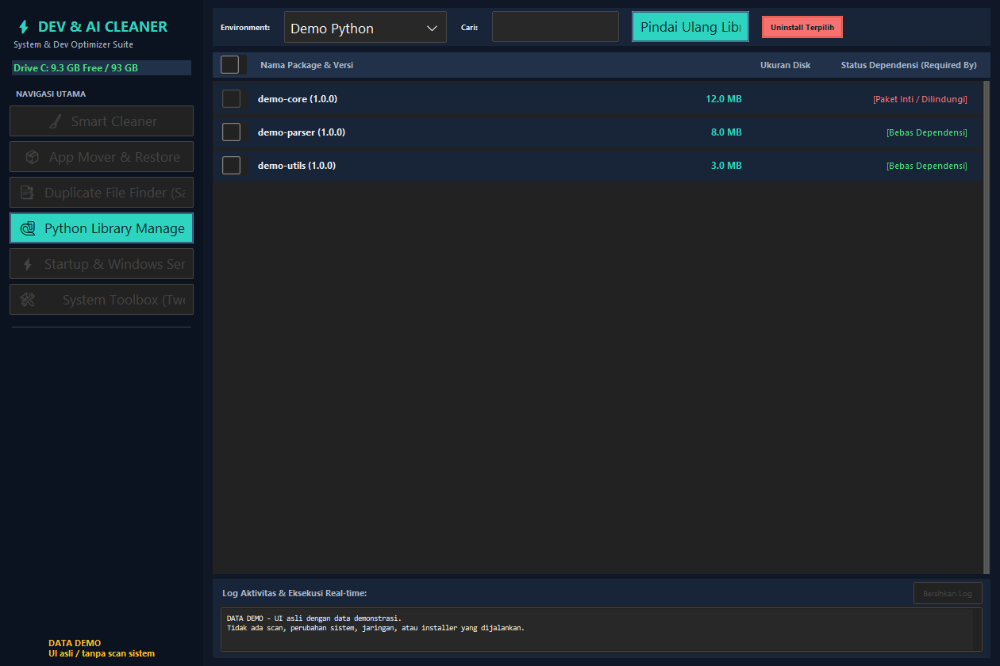
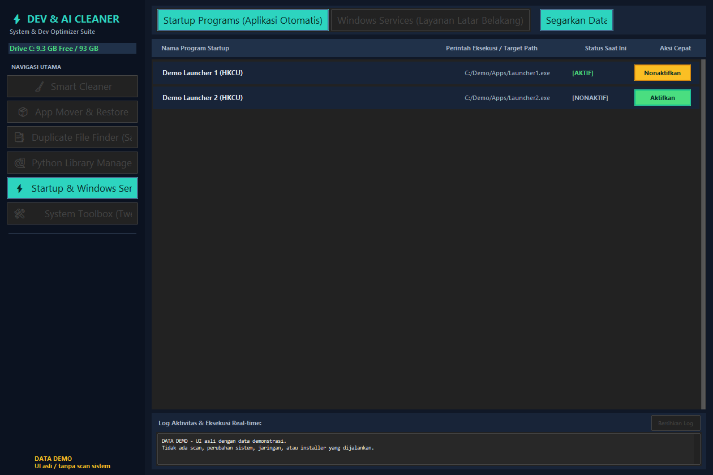
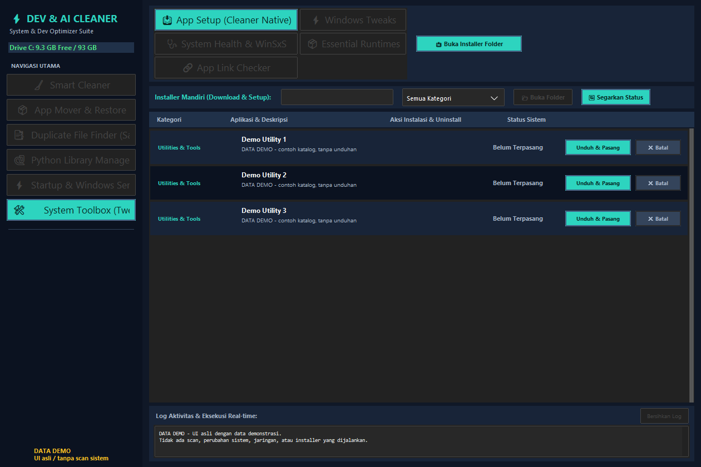

# Screenshot aplikasi

Semua gambar di halaman ini adalah **UI asli dengan data demonstrasi**, bukan mockup atau hasil scan komputer pengguna. Label **DATA DEMO** ditampilkan di jendela aplikasi. Nama aplikasi, package, path `C:/Demo`, kapasitas disk, dan status pada tabel adalah contoh sintetis, bukan inventaris perangkat atau rekomendasi untuk menghapus item tertentu.

## Enam tampilan utama

### Smart Cleaner



UI asli dengan data demonstrasi: tabel cache, ukuran, pilihan item, dan ringkasan pembersihan. Tidak ada pemindaian atau pembersihan yang dijalankan.

### App Mover & Restore



UI asli dengan data demonstrasi: daftar aplikasi contoh dan kontrol pemindahan/pemulihan. Target `C:/Demo/Target` hanya penanda demonstrasi, **bukan target pemindahan yang valid**; pemindahan sebenarnya memerlukan drive non-C. Tidak ada folder atau junction yang dibuat.

### Duplicate File Finder (Safe)



UI asli dengan data demonstrasi: satu grup berkas duplikat sintetis, pilihan salinan, dan estimasi ruang. Tidak ada berkas yang dibaca untuk hashing atau dikirim ke Recycle Bin. Status Storage Sense tidak dibaca atau diubah.

### Python Library Manager



UI asli dengan data demonstrasi: environment dan package contoh, ukuran, serta status perlindungan. Tidak ada interpreter lain, pip, atau proses uninstall yang dijalankan.

### Startup & Windows Services



UI asli dengan data demonstrasi: tab program startup dengan nama dan command generik. Tidak ada registry atau metadata layanan komputer yang dibaca; tidak ada status startup/layanan yang diubah.

### System Toolbox (Tweaks & Tools)



UI asli dengan data demonstrasi: subview App Setup memakai katalog contoh. Tidak ada status software nyata yang dideteksi, koneksi jaringan, unduhan, installer, atau tweak Windows yang dijalankan.

## Regenerasi

Persyaratan: Windows dengan sesi desktop interaktif, Python 3.10+, dependensi aplikasi (`psutil`), dan Pillow. Tidak perlu hak Administrator. Jalankan dari root checkout yang berisi versi sumber dan `tests/test_bootstrap_layout.py` terbaru:

```powershell
python tools/capture_screenshots.py
```

Untuk pemeriksaan awal tanpa mengganti gambar dokumentasi:

```powershell
python tools/capture_screenshots.py --output-dir "$env:TEMP/cleaner-screenshot-preview"
```

Helper membuka aplikasi Tk yang sebenarnya, memasukkan baris contoh melalui metode render asli, dan mengaktifkan keenam menu melalui callback navigasi asli. Ukuran setiap gambar adalah **1260 × 840 piksel area klien**; title bar, taskbar, jendela lain, dan desktop tidak diambil. Capture memakai Windows `PrintWindow` untuk HWND aplikasi lalu Pillow untuk penyimpanan PNG. Bila capture gagal atau kosong, helper berhenti—tidak beralih ke screenshot seluruh layar.

Sebelum aplikasi dibuat, helper memakai patch `BOOTSTRAP` dari pengujian layout untuk meniadakan startup scan, discovery environment/drive, katalog, dan inisialisasi state Windows. APPDATA, LOCALAPPDATA, profil pengguna, preferensi, riwayat, serta direktori unduhan diarahkan ke folder sementara. Executor jobs, thread baru, subprocess, jaringan, registry, traversal scan, dan entrypoint mutasi ditolak. Audit hook juga menolak penulisan di luar folder sementara selama GUI hidup. Permintaan kerja tak terduga atau error callback Tk membatalkan hasil; enam PNG dipublikasikan hanya setelah semua capture berhasil. Callback tertunda, executor, jendela Tk, patch, dan state sementara dibersihkan pada akhir proses.

Setelah regenerasi, **buka keenam PNG** dan periksa bahwa label navigasi terbaru terlihat, toolbar/tabel/log tidak terpotong, label DATA DEMO terbaca, serta tidak ada username, path profil, aplikasi terpasang, atau metadata layanan nyata. Jangan menggunakan gambar hasil capture yang gagal atau belum diperiksa.
